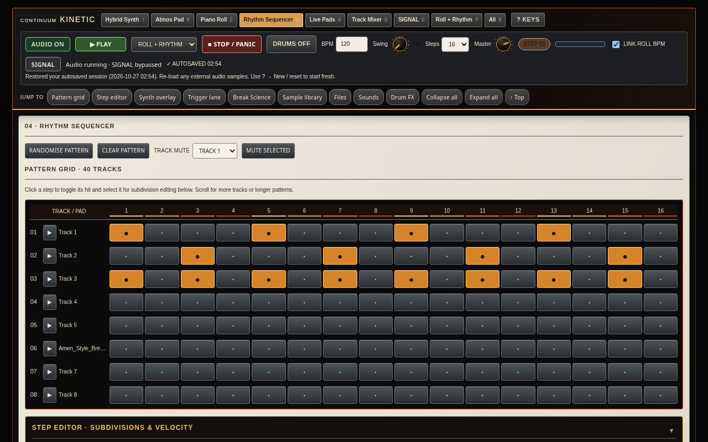
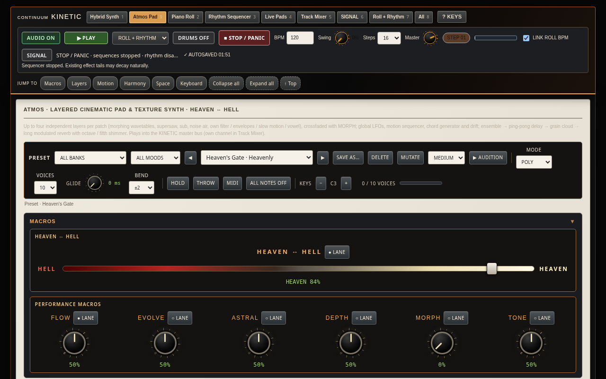

# CONTINUUM KINETIC

**A browser music workstation in a single HTML file — hybrid synth, 8-layer Atmos pad synth, piano roll, rhythm sequencer, Break Science slicer, rhythmic noise gate and a Supabase sample library, all on the Web Audio API.**




---

## Contents

- [Overview](#overview)
- [Quick start](#quick-start)
- [Features](#features)
  - [Workflow](#workflow)
  - [Atmos pad synth](#atmos-pad-synth)
  - [Noise gate](#noise-gate)
  - [Rhythmic gate patterns](#rhythmic-gate-patterns)
  - [Break Science](#break-science)
  - [Sample library (Supabase)](#sample-library-supabase)
  - [Piano roll & automation](#piano-roll--automation)
  - [Mixer, SIGNAL & host tools](#mixer-signal--host-tools)
- [Keyboard shortcuts](#keyboard-shortcuts)
- [MIDI](#midi)
- [Projects, presets & storage](#projects-presets--storage)
- [Browser support & performance](#browser-support--performance)
- [Architecture & porting notes](#architecture--porting-notes)
- [Roadmap & known limitations](#roadmap--known-limitations)
- [Contributing](#contributing)
- [License](#license)
- [Credits](#credits)

---

## Overview

CONTINUUM KINETIC is a complete music workstation that runs from one file: `continuum-kinetic-combined.html`. You don't install anything, there's no framework and no server-side code. Its tabbed workspaces are:

| Workspace | What it does |
|---|---|
| **Hybrid Synth** | Hybrid / acid synth with articulation (slide, accent) and a 24 × 16 synthesis-sequencing overlay with per-step velocity, gate, cutoff, resonance and glide |
| **Atmos Pad** | 8-layer pad / strings synth with 144 presets, macros, MORPH, a noise gate and a rhythmic trance gate |
| **Piano Roll** | Note editor with automation lanes. Plays the Hybrid synth, Atmos or both |
| **Rhythm Sequencer** | 40-track step grid with a subdivision / velocity step editor, trigger lane and Break Science slicer |
| **Live Pads** | Pad performance surface |
| **Mixer** | Per-track channels with optional per-channel noise gate and choke groups |
| **SIGNAL** | Amp / pedal stage, with an optional pre-SIGNAL gate |
| **Roll + Rhythm / All** | Combined views |



---

## Quick start

1. Download `continuum-kinetic-combined.html`.
2. Open it in a **Chromium-based browser** (Chrome, Edge, Brave and so on). Opening the file directly works.
3. Click **AUDIO ON** (or anything else that starts audio). Browsers only allow audio to start after a user gesture.

Serving it from a local web server is recommended:

```bash
python3 -m http.server 8000
# then open http://localhost:8000/continuum-kinetic-combined.html
```

**Why serve it?** When the page is opened as a file, it has an opaque `file://` origin:

- **AudioWorklet:** Chromium may refuse an inline Blob module from that origin. The noise gate then retries with a `data:` URL, and an analyser-based fallback exists if both fail.
- **Web MIDI and storage:** both behave more predictably on `http://localhost`.

---

## Features

### Workflow

- **Tabbed workspaces** with `Alt+1…9` shortcuts. Each tab remembers its own scroll position.
- **Pinned master transport** in the header: PLAY, play-scope selector, STOP / PANIC, a single DRUMS ON/OFF toggle, BPM, swing, steps and master level.
- **Jump bar** to sections within the current tab (pattern grid, step editor, synth overlay, trigger lane, Break Science, sample library, files, sounds, drum FX…), plus collapse / expand all.
- **Autosave** to `localStorage`, restored on load.
- **Undo / redo** for notes, automation lanes and rhythm-grid edits. The Break Science slicer has its own UNDO.
- **Export / import** of the whole project as JSON.

### Atmos pad synth

- **8 layers.** Each has two sources (oscillator / wavetable / FM / **library sample**), sub, noise, filter, amp and filter envelopes, and on / mute / solo / level / MORPH side.
  - Layers that are switched off create no audio nodes.
  - A global voice budget (48) scales the per-layer voice cap automatically.
  - A **CPU / voices meter** shows the current load.
  - **COPY L→** and **INIT LAYER** per layer.
- **Macros:** FLOW · EVOLVE · ASTRAL · DEPTH · MORPH (A ↔ B layer crossfade) · TONE, plus the **HEAVEN ↔ HELL** processor (ring-mod grit, stepped shaper, metallic comb, morphing formant bank).
- **FX:** shimmer, reverb, grain cloud with freeze, delay with dub throws, ensemble, riser.
- **MUTATE** and user presets.
- **Two-stage panic** on ALL NOTES OFF, STOP / PANIC, `Esc` and MIDI CC120 / CC123:
  - **First press:** releases every voice, including HOLD and sustain. Riser, motion and gate scheduling stop, feedback regeneration stops, and tails decay naturally.
  - **Hard kill:** a second press within 1.5 s, the STOP / PANIC button or CC120. Flushes reverb, delay, shimmer, grain and freeze.
- **144 presets** in 23 banks.

<details>
<summary><b>Preset banks (144 presets including Init)</b></summary>

| Bank | # | Presets |
|---|---|---|
| Ethereal Cereal | 6 | Sugar Stars, Marshmallow Moon, Milk & Glitter, Fairy Floss Choir, Soggy Leftovers, Midnight Snack |
| Astral Pastels | 6 | Lavender Haze, Peach Nebula, Mint Aurora, Astral Drift, Cotton Comet, Faded Polaroid |
| Cinematicalizer | 7 | Celestial Strings, Trailer Braam, Hell Braam, Tormented Strings, Apocalypse Riser, Victory Horizon, Gated Cathedral |
| Liminal Criminal | 6 | Empty Mall 3AM, Backrooms Hum, The Void Watches, Frozen Horizon, Dead Air, Hallway With No End |
| Entheogenics | 6 | Interstellar Bloom, Mescaline Mandala, Bad Trip, Ayahuasca Vines, Ego Dissolve, Kaleidoscope Shift |
| Dub Sutra | 9 | Basic Channel Chord, Om Drone, Echo Chamber Sutra, Submerged Skank, Concrete Sutra, Sulphur Dub, Sound System Nebula, Rockers Haze, Dub Siren Cathedral |
| Botanicals | 6 | Fern Breath, Woodland Pluck, Rain Canopy, Root Network, Carnivorous Bloom, Morning Dew Garden |
| Climactic Sweeps | 6 | Aurora Swell, Tension Riser, Descent, Doomsday Countdown, Ascension, Pressure Build |
| Depth Charges | 7 | Dark Matter Drone, Pressure Wave, Abyssal Tide, Kraken Wakes, Sonar Ping, Trench Drone, Pulse Monolith |
| Swirling Vortexes | 6 | Solar Wind, Leslie Nebula, Maelstrom, Halo Spin, Whirlpool, Tornado Alley |
| Hybrid Synthesis | 6 | FM Glass Hybrid, Ninth Circle, FM Bass Pad, Digital Aurora, Circuit Bent Hell, Analog Ghost Machine |
| Heaven & Hell | 9 | Nebula Choir, Heaven's Gate, Inferno, Hellfire Choir, Fallen Angel, Purgatory, Ice Cathedral, Cathedral of Light, Black Cathedral |
| Derivation Station | 6 | Seed Pattern, Generation Loss, Mutant Bloom, Feral Offspring, Recursive Drone, Golden Ratio |
| Tantric Tapestry | 6 | Tanpura Shimmer, Sympathetic Strings, Sitar Dusk Swell, Kundalini Coil, Kali Dance, Lotus Bloom |
| Squelchfest | 6 | Acid Pad 303, Wobble Mire, Squelch Choir, Acid Rain Hell, Rubber Bubbles, Filter Swamp |
| Tribal | 11 | Log Drum Pulse, Bamboo Flute Gate, Fire Circle, Night Ritual, Sun Dance, War Drums of Dis, Kick-Keyed Choir, Jungle Temple House, Conga Pulse Pad, Dust Engine, Tom Ritual Noise |
| Ancestral | 6 | Didgeridoo Earth, Overtone Elders, Dust of Ages, Bone Throne, Spirit Ancestors, Cave Paintings |
| Quantum Flux | 6 | Probability Cloud, Heisenberg Glitch, Entangled Particles, Schrodinger Box, Singularity Collapse, Quantum Foam |
| Octave Stack | 6 | Seraphim Stack, Prism Lattice, Obsidian Monolith, Eight Watchers, Legion, Heaven To Hell Ladder *(all 8 layers)* |
| Rhythmic Gates | 6 | Lagos Shimmer, Amen Cathedral, Rollers Halo, Sleng Teng Nebula, Jungle Pressure, Tresillo Bloom |
| Gate Lab | 7 | Stutter Halo, Full-On Nebula, Mechanical Chapel, Off-Beat Squelch Galaxy, Ducking Monolith, Drop Accelerator, Glitch Prayer |
| Tribal Psy | 3 | Ritual Rolling Bass, Shaman Triplets, Jungle Spirit 140 |
| — | 1 | Init |

</details>

### Noise gate

An `AudioWorkletProcessor` (`kin-noise-gate`) loaded from inline source, with an analyser-based fallback.

- **Controls:** threshold, range, attack, hold, release, hysteresis, look-ahead (≤ 10 ms), detector HPF, stereo-linked detection, punch, drive (DISTORT → ultra-fast gate), open / closed **LED**.
- **Modes:**
  - **CLEAN:** noise gate.
  - **TIGHTEN:** drum tightening with look-ahead and punch.
  - **RHYTHM:** keyed / patterned gating.
  - **DUCK:** inverted.
- **Key sources:** self, trance-gate pattern, drum track, piano roll, a hidden **TRIGGER LANE** (own step grid with velocity), a library sample, any mixer track (mixer inserts), or self filtered low / mid / high.
- **Band options:** full band, gate only highs or only lows (LR4 split), or a **3-band multiband** gate with per-band threshold and a link option.
- **TARGET mode:** band-energy spectral match against KICK / SNARE / HAT / TOM / VOCAL / BASS fingerprints. Includes a **LEARN** button and a similarity meter. This is spectral matching, not source separation.
- **Where it can sit:**
  - Atmos insert, before or after reverb.
  - Per-channel mixer insert.
  - Pre-SIGNAL stage.
  - Noise bed.
- Gate settings are saved in autosave, export and presets, and panic resets the gate.

### Rhythmic gate patterns

A shared, tempo-synced pattern library used by the Atmos trance gate:

- **Steps and timing:** 16 / 32 steps, 1–4 bars, swing, humanise, smoothing.
- **Per step:** level, accent and probability. Probability is approximated with a 4-cycle variation buffer.
- **Per-step curve shapes.**
- **Divisions:** down to 1/64, including 1/16T, 1/24, 1/32T and 1/48.
- **A/B/C/D pattern chains** with a fill every *N* bars.
- **ACCEL / DECEL rate ramps** that the Riser can trigger.
- **Multi-target:** the pattern can also step filter cutoff and pan.
- **Editable grid:** click toggles a step, drag sets its level, right-click sets probability, Shift sets accent. You can save your own patterns, and there's a **Euclidean generator**.

<details>
<summary><b>59 factory patterns</b></summary>

| Group | Patterns |
|---|---|
| GENERIC (7) | Gated Classic, Straight 8ths, Straight 16ths, 8th Triplets, Dotted 8ths, Euclid 5/16, Euclid 7/16 |
| AFROBEAT (5) | Lagos Drummer Hats, 12/8 Standard Bell, Shekere Accents, Afro Clave 3-2, Highlife Horn Stabs |
| DNB (4) | Two-Step, Rolling 16ths, Amen Gate, Half-Time |
| RAGGA (4) | Sleng Teng Skank, One Drop, Steppers, Tresillo 3-3-2 |
| JUNGLE (4) | Chopped Amen, Ragga Jungle, Rollers Ghosts, Time-Stretch Stutter |
| STUTTER HOUSE (4) | House Stutter 32nds, Triplet Stutter 1/24, Machine Gun 1/64, Stutter 1/48 Roll |
| PSY / FULL-ON (5) | Full-On Rolls, Off-Beat Squeak, Off-Beat Only 8ths, 3 Over 4, Gallop Roll |
| GLITCH / IDM (5) | Micro Chops, Irregular 5+7, Broken Probability, Polymeter 7, Polymeter 5 |
| BASS MUSIC (5) | Half-Time Wobble, Triplet Stabs, Dubstep Half-Time, Wobble 1/8, Pump 4/4 (for DUCK) |
| TRIBAL HOUSE (5) | Conga Groove 16ths, Offbeat Open Hat, Shuffled Perc Pulse, Call & Response, Tom Roll Groove |
| RAGGA DUB (4) | Rockers, Dub Skank Chop, Steppers Dub, One Drop Dub |
| TRIBAL TECHNO (3) | Dust On Hits 16ths, Tom Ritual, Tribal Techno Pulse |
| TRIBAL PSY (4) | KBBB Psy, Psy Triplet Roll, 3-Against-4 Perc, Shaman Gallop |

</details>

### Break Science

A break-slicing toolkit inside the rhythm sequencer.

- **Source:** a **synthesized amen-style 4-bar break** (137 BPM, generated in code; the original recording is *not* included), a library sample or any track's sample.
- **Slicing:** by grid or by transients, one slice per step. Each step can set pitch, reverse, gain, offset, ratchet / roll and stutter.
- **Choke groups** with an adjustable choke time.
- **Transient gate:** a predictive, full look-ahead gate with a band-split detector, baked into the buffer.
- **Drumfunk tempo-up:** resamples the break to the project BPM.
- **Randomize** with an intensity control. It is seeded and can be undone.
- **Integration:** follows BPM and swing, plays through the mixer (its own track), sends `drum` key pulses to the gates, and stops on panic.
- **Patterns:** Straight Break, Science Chop, Choke Geometry, Drumfunk Roller, Clinical Edge, Amen Shrapnel, Dusty Separation.

### Sample library (Supabase)

The library is **read-only**: it only lists and downloads, and never writes to or deletes anything in storage.

- **Indexing:** walks every folder of the bucket with paginated listing (1000 per page). Listings and the index are cached in IndexedDB.
- **Browsing:** search by name / folder / tag, type filter, and favourites / recent / per-project **crate** views.
- **Preview:** waveform thumbnail, auto-stop, preview volume, optional sync to the project BPM.
- **BPM and key** are read from filenames (e.g. `…_170bpm_Am.wav`). A BPM is estimated from onsets when the filename has none.
- **Downloads** show progress and can be cancelled. Decoded audio is held in an LRU cache.
- **SEND TO** or **drag-and-drop** onto the Break Slicer, any track / pad, an Atmos layer (SAMPLE source), the Atmos gate key or the noise bed.
- **Projects store storage paths, not audio.** Samples are downloaded again when a project loads, and any that are missing are listed in a warning without stopping the load.

**Setup**

1. Create a Supabase project and a Storage bucket for your samples.
2. In the library panel, set the project URL (`https://<your-project-ref>.supabase.co`), the bucket name (`<your-bucket>`) and a **publishable / anon key**. *The project URL and bucket name are set in the source.*
3. Make the bucket readable with **read-only** storage policies (list / select only). Grant no insert, update or delete.

> **Security:** never put a service-role key in the HTML or commit secrets to the repo. Publishable / anon keys are designed to be public, but they're only safe if Row Level Security and storage policies limit them to reading.

### Piano roll & automation

- Multi-select, copy / paste / duplicate, and undo.
- **Automation lanes** that you record live (ACID CUTOFF, ACID RESONANCE, FM INDEX, FM LEVEL, ANALOGUE WARMTH, ANALOGUE LEVEL, …).
- **Instrument target:** Hybrid / Obsidian, Atmos Pad or both.
- **Routing:** the roll can route to synth / drums / both, and each grid track can be routed to the synth at a chosen pitch.

### Mixer, SIGNAL & host tools

- **Per-channel GATE** (mode, key, key track, threshold, release, LED) and **choke groups**. Settings are saved with the track.
- **SIGNAL** amp / pedal stage, with an optional **pre-SIGNAL noise gate**.
- **NOISE BED:** continuous white / pink / vinyl noise or a sample loop, gated by drum hits or the trigger lane. **Dust On Hits** sets it up in one click.
- **PSY BASS:** hard-gated KBBB / triplet rolling bass that ducks on the kick. Root and note sequence are adjustable, and it can play its internal saw or Atmos. Presets: KBBB Classic, Triplet Roller, Offbeat Rumble.

---

## Keyboard shortcuts

| Keys | Action |
|---|---|
| `Space` | Play / stop (scope set by the selector next to PLAY) |
| `Esc` | STOP / PANIC: stop everything and release all notes. In Atmos, pressing it twice within 1.5 s is a hard kill |
| `Alt`+`1` … `9` | Hybrid Synth · Piano Roll · Rhythm · Pads · Mixer · SIGNAL · Roll + Rhythm · All · Atmos Pad |
| `[` / `]` | Previous / next section |
| `R` (Piano Roll views) · `Shift`+`R` (anywhere) | Arm / disarm automation recording on the selected lane |
| `Ctrl/⌘`+`Z` · `Ctrl/⌘`+`Shift`+`Z` / `Y` | Undo / redo (notes, automation lanes, rhythm-grid edits) |
| `Ctrl/⌘`+`C` / `V` / `D` / `A` | Copy · paste at selected bar · duplicate → next bar · select all notes |
| `Delete` / `Backspace` | Delete selected notes |
| `Ctrl/⌘`+`S` | Export project (JSON) |
| `Ctrl/⌘`+`O` | Import project |
| `?` | Shortcut / help panel |
| `1`…`0`, `Q`…`P` | Trigger tracks 1–20 (`R` is the record key while a Piano Roll view is shown) |
| **Atmos tab:** `A` `W` `S` `E` `D` … `;` `'` | Play notes in a piano layout (`Shift` = full velocity). Pad letter keys are muted on this tab |
| **Atmos tab:** `Z` / `X` | Octave down / up |
| **Atmos tab:** double-click a knob | Reset it to the preset value |

---

## MIDI

Uses Web MIDI (Chromium). The Atmos mappings are:

| Message | Function |
|---|---|
| Note on / off | Play notes |
| CC64 | Sustain pedal |
| CC1 (mod wheel) | MORPH |
| CC2 / CC11 | EVOLVE |
| CC123 | All notes off (first-stage panic) |
| CC120 | All sound off (hard kill) |
| Pitch bend | Pitch bend |

---

## Projects, presets & storage

- **Export / import:** `Ctrl/⌘+S` / `Ctrl/⌘+O`. The JSON includes tracks and steps, piano-roll notes, automation, synth settings, and a `combined` section with the trigger lane, gates, noise bed, psy bass, Break Science, synthesis overlay / acid settings and library references.
- **Atmos state** covers all 8 layers. Saves from the older 4-layer version still load.
- **Samples** are referenced by storage path and downloaded again on load; audio is never embedded.
- **`localStorage` keys** (selection):

| Key | Contents |
|---|---|
| `kinetic.autosave.v1` | Full project autosave |
| `kinetic.atmos.userPresets.v2` | Atmos user presets |
| `kinetic.atmos.gatePatterns.v1` | User gate patterns |
| `kinetic.combined.triggerLane.v1` | Trigger lane |
| `kinetic.combined.breakSci.v1` | Break Science state |
| `kinetic.combined.noiseBed.v1` / `.psyBass.v1` / `.signalGate.v1` | Host tools |
| `kinetic.lib.favs` / `.tags` / `.recent` / `.refs` | Library metadata |
| `continuum-kinetic-synth-overlay-v1` / `continuum-kinetic-unified-routing-v1` | Synthesis overlay and grid routing |

---

## Browser support & performance

- **Target:** current Chromium-based desktop browsers. Other browsers haven't been tested.
- **CPU:** a dense 8-layer patch is expensive. For example, *Seraphim Stack* with a 5-note chord shows about 95 % on the built-in CPU meter. If audio crackles:
  - switch off unused layers (they cost nothing),
  - lower unison,
  - play fewer notes.
- The **voice budget** (48 voices) is shared across the active layers. The per-layer cap is ⌊48 / active layers⌋, with a minimum of 2.
- Only one Atmos noise-gate instance is built per engine. Inactive gates and layers create no nodes.

---

## Architecture & porting notes

DSP is kept separate from UI so the engine can be ported.

| Module | Role |
|---|---|
| `atmos8/engine.js` | Atmos DSP engine (layers, FX, panic, gate patterns, keys) |
| `atmos8/noisegate.js` | Noise-gate AudioWorklet and wrapper (split / multiband / target) |
| `atmos8/presets.js` | Preset data and level trims |
| `atmos8/ui.js` | Atmos UI, MIDI, parameter registry |
| `combined/breakdsp.js` | Portable break DSP: synthesis, onsets, slicing, BPM estimate, gate baking, slicer |
| `combined/breaksci.js` | Break Science UI and scheduler |
| `combined/hostgate.js` | Mixer / SIGNAL gates, noise bed, psy bass |
| `combined/seqglue.js` | Sequencer glue: step hooks, gate-key fan-out, choke, trigger lane, project extras |
| `combined/library.js` | Supabase library browser |
| `refine/refine.js`, `refine/refine.css` | Workflow layer (tabs, transport, shortcuts, undo, autosave) |

- **Parameter registry:** `window.ATMOS_PARAM_REGISTRY` (built in `atmos8/ui.js`) is the single source of truth for every parameter. Each entry has `id`, `name`, `type`, `min`, `max`, `default`, `unit`, `options` and `automatable`.
- **JSON formats:**
  - Presets: flat `{ "param.id": value }` maps.
  - Gate patterns: `window.ATMOS_GATE_PATTERNS`.
  - Break patterns: `KinBreakDSP.BREAK_PATTERNS`.
  - Projects: see above.
- **Rebuilding:** the HTML is assembled from the sources:

```bash
python3 build_combined.py   # writes continuum-kinetic-combined.html
```

`build_combined.py` starts from the sequencer base HTML, adds the workflow layer, the Atmos sources (`atmos8/`) and the `combined/` modules, and patches a few anchors.

**Planned:** DAW plugin ports (VST3 / AU / CLAP) and a standalone app, built on the DSP modules and the parameter registry. These aren't started yet.

---

## Roadmap & known limitations

Not built yet:

- [ ] FFT spectral gate mode (and the *Vocal Air Keeper* / *Rumble Clamp* presets)
- [ ] Stutter-repeat slice capture
- [ ] Drawn custom gate curves (per-step preset shapes are implemented)
- [ ] Grain cloud fed from a library sample
- [ ] Waveform thumbnails cached in IndexedDB
- [ ] Atmos trance-gate pattern as a key for mixer gates
- [ ] DAW plugin and standalone ports

Known limitations:

- Gate step probability is approximated with a 4-cycle variation buffer.
- Break Science has its own undo, separate from the global undo.
- The amen-style break is **synthesized**. The original recording is not included.
- TARGET mode is a lightweight band-energy spectral match, not source separation.
- STOP / PANIC silences the new modules instantly, but the base drum kit's one-shots and shared FX tails still decay naturally.
- The SIGNAL pedalboard is a sealed sub-app, so its gate sits just before it rather than inside it.

---

## Contributing

Issues and pull requests are welcome.

- Keep DSP changes in the DSP modules and UI changes in the UI files.
- Register new parameters through the parameter registry.
- Rebuild with `build_combined.py` and test in a Chromium browser. Check for console errors and NaNs.
- Use original names for presets and patterns (no artist or commercial product names).

---

## License

*No license has been chosen yet.* Add a `LICENSE` file before publishing.

## Credits

*Author / credits: add your name here.*
